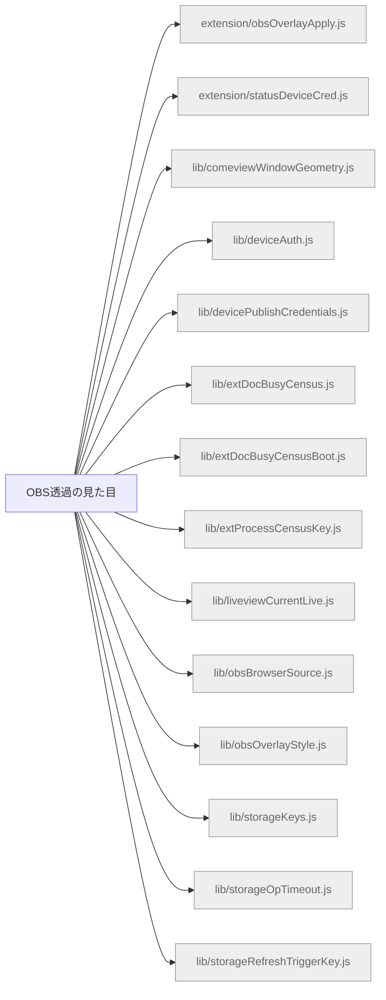

# 機能マップ: OBS透過の見た目（`obs-style`）

> `npm run feature-map` で再生成。手で編集しない。
> 起点 entry: `src/extension/obs-style-entry.js`

## storage の出入り

- 書くキー: `KEY_OBS_BROWSER_SOURCE`, `KEY_OBS_OVERLAY_STYLE`, `KEY_STATUS_DEVICE_CRED`
- 読むキー: `KEY_COMEVIEW_WINDOW_GEOMETRY`, `KEY_LAST_WATCH_URL`, `KEY_OBS_BROWSER_SOURCE`, `KEY_OBS_OVERLAY_STYLE`, `KEY_STATUS_DEVICE_CRED`, `KEY_STATUS_UPLOAD_CONFIG`

## 構成ファイル（import 到達・最大40件表示）

