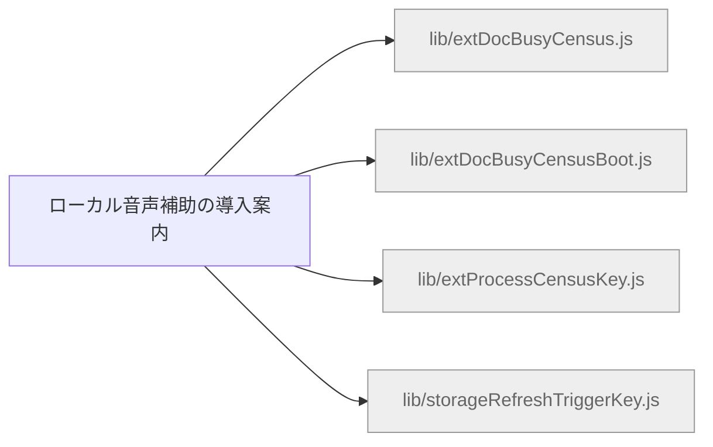

# 機能マップ: ローカル音声補助の導入案内（`voice-native-guide`）

> `npm run feature-map` で再生成。手で編集しない。
> 起点 entry: `src/extension/voice-native-guide-entry.js`

## storage の出入り

- 書くキー: (なし)
- 読むキー: (なし)

## 構成ファイル（import 到達・最大40件表示）

